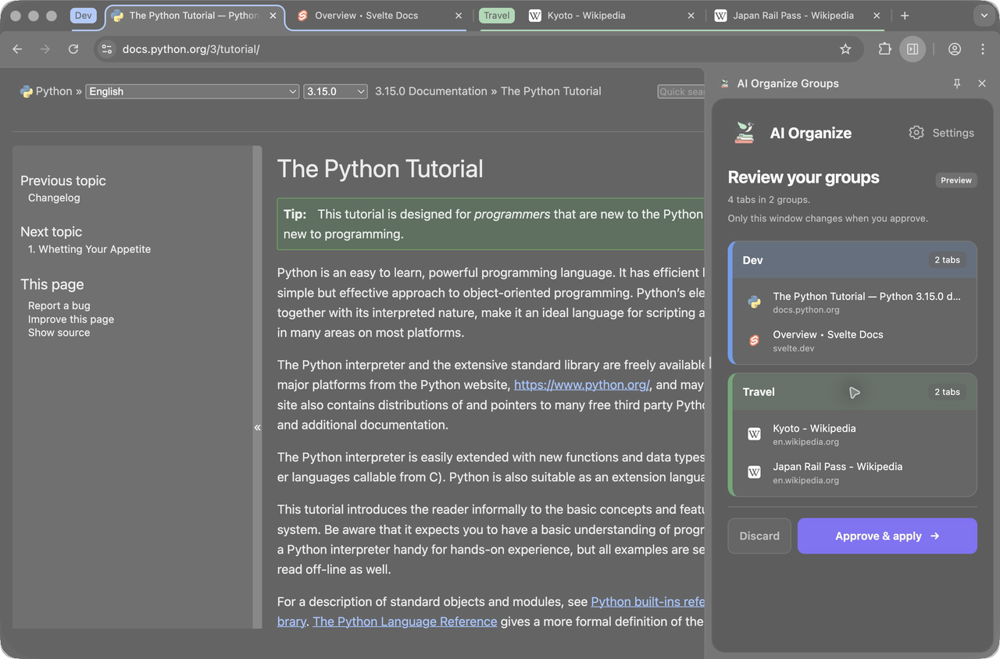

  

<h1 align="center">
  AI Organize
</h1>

AI Organize is a small Chrome extension that groups your open tabs by topic.
Review the suggestions before applying them. Approved groupings are saved
and retrieved with vector search to guide future suggestions.

  

## Use

1. Open the extension and add your OpenAI API key.
2. Click **Organize** to preview groups for the current window.
3. Choose **Approve & apply**, or **Discard** to leave your tabs unchanged.

Currently distributed privately through the Chrome Web Store.
